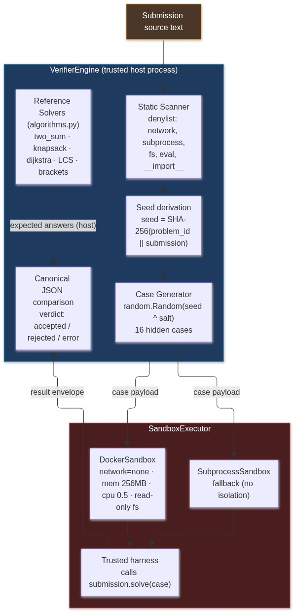
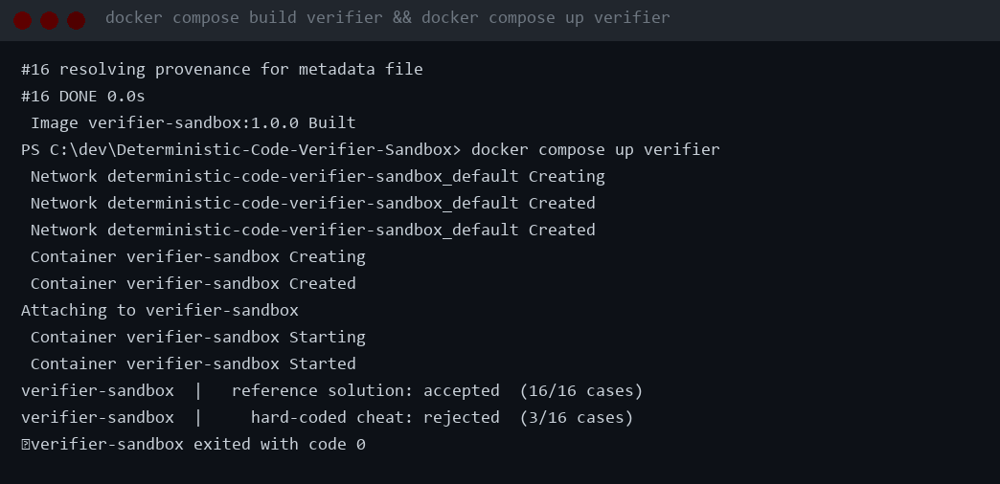
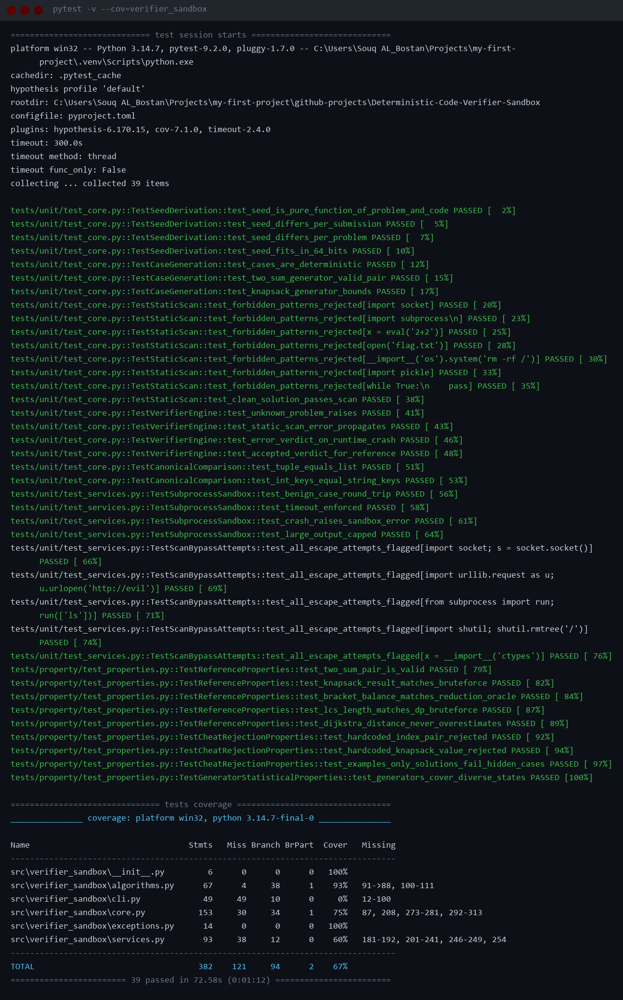
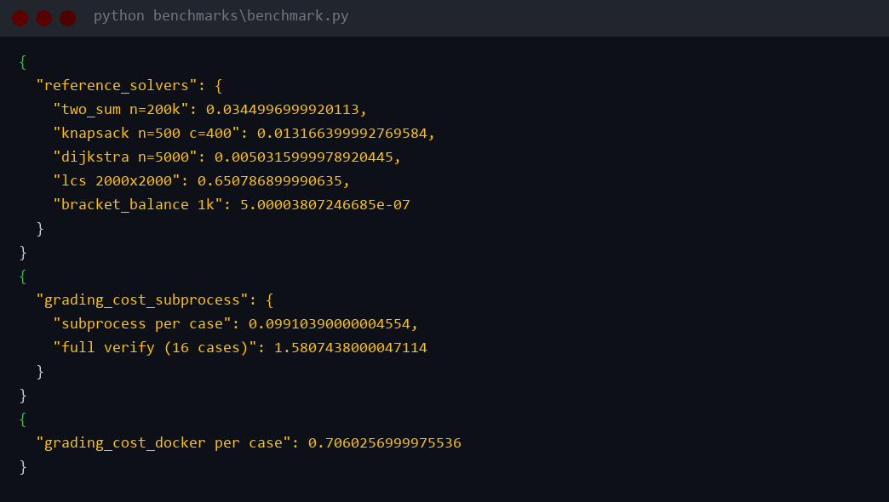

# Deterministic-Code-Verifier-Sandbox

**A professional Python engineering project demonstrating environment reproducibility, deterministic verifiers, and secure untrusted-code execution.**

[](LICENSE)
[](https://opencode.ai)


## 1. Project Overview

**Problem.** When an LLM (or any generator) produces code, that code must be
graded before anyone can trust it. Grading untrusted code is deceptively
hard: generated solutions can hard-code the test answers, crash the grader,
exhaust memory, or try to phone home.

**Why it is technically challenging.**

- A verifier that only checks *public example inputs* is trivially gamed by
  memorizing the samples.
- The same submission must get the same verdict on every machine, every run
  -- otherwise grading is an opinion, not a measurement.
- Executing hostile code requires hard resource isolation, and the isolation
  itself must not change the verdict.

**Solution.** This project is a grading engine built around three ideas:

1. **Deterministic randomized verification** -- the case set is derived from
   `SHA-256(problem_id || submission_text)`, so a submission's 16 hidden
   cases are random *and* exactly reproducible.
2. **Host-side ground truth** -- expected answers are always recomputed by
   trusted reference solvers; the sandbox only observes untrusted output.
3. **Defense in depth** -- a static denylist scan, then container execution
   with no network, kernel memory caps, CPU quotas and read-only mounts.

## 2. Key Features

- Advanced algorithmic reference solutions (hash-map lookup, bottom-up DP,
  heap-based Dijkstra, two-row LCS DP, stack parsing).
- Deterministic automated verification: verdict is a pure function of the
  submission text.
- Reproducible Docker environment (one image, three compose services).
- Multi-layer sandbox: static scan → container isolation → output caps →
  wall-clock kill.
- Property-based testing (Hypothesis) with independent oracles proving
  every reference solver correct on arbitrary inputs.
- Adversarial test suite proving hard-coded and sample-memorizing
  submissions are rejected.
- Performance optimization: canonical JSON comparison, O(min(m,n)) LCS
  memory, O(n·capacity)/O(1)-space knapsack DP.
- Automated CI testing on GitHub Actions (lint, strict typing, tests,
  container integration job).

## 3. System Architecture



The full component view and data-flow narrative are in
[`docs/architecture.md`](docs/architecture.md). In short: the trusted host
engine generates seeded cases and computes ground truth; untrusted code is
reduced to a pure function executed inside a disposable sandbox per case;
grading compares canonical JSON against host-computed truth.

## 4. Technology Stack

| Technology | Purpose |
|---|---|
| Python 3.11+ | Core implementation, full type hints |
| Docker + docker SDK | Disposable, network-isolated execution |
| Pytest | Automated unit/integration testing |
| Hypothesis | Property-based reference validation |
| Ruff | Linting and code quality |
| MyPy (strict) | Static type checking |
| GitHub Actions | Continuous integration |
| Docker Compose | One-command reproducible environment |

## 5. Repository Structure

| Path | Purpose |
|---|---|
| `src/verifier_sandbox/` | Engine (`core.py`), sandboxes (`services.py`), reference solvers (`algorithms.py`), errors, CLI |
| `problems/` | Problem registry, generators, reference + cheat fixtures |
| `tests/unit/` | Seed derivation, case generation, scanner, sandbox mechanics |
| `tests/property/` | Hypothesis oracle tests + adversarial cheat rejection |
| `tests/integration/` | Real Docker-container end-to-end tests (skipped w/o daemon) |
| `tests/fixtures/` | Reference, hard-coded cheat and sample-memorizer submissions |
| `docs/` | Architecture, design decisions, security, verification strategy, debugging log |
| `benchmarks/` | Reproducible benchmark + measured results |
| `scripts/` | Environment setup and test runner |
| `.github/workflows/` | CI: quality matrix + container integration job |

## 6. Installation and Setup

```bash
git clone https://github.com/<you>/Deterministic-Code-Verifier-Sandbox
cd Deterministic-Code-Verifier-Sandbox

# Option A: zero-config Docker (recommended)
docker compose build

# Option B: local environment
python -m venv .venv
source .venv/bin/activate          # Windows: .venv\Scripts\activate
pip install -r requirements.txt
pip install -e .
```

A running Docker daemon is required for container-mode grading and the
integration test suite; everything else works without it (the subprocess
fallback is used automatically and honestly labeled).

## 7. Execution

```bash
# Grade the bundled reference solution and the bundled hard-coded cheat
docker compose up verifier

# Grade any submission file
docker compose run --rm verifier \
    python -m verifier_sandbox.cli verify --problem two_sum \
    --submission tests/fixtures/reference_two_sum.py
```

Expected output: `reference solution: accepted (16/16 cases)` and
`hard-coded cheat: rejected`. Stop everything with:

```bash
docker compose down
```



## 8. Testing and Verification

```bash
# Unit + property suites
pytest tests/unit tests/property -v

# Coverage
pytest --cov=verifier_sandbox --cov-report=term-missing

# Container integration suite (needs Docker)
pytest tests/integration -v
```

Test layers:

- **Unit tests** -- seed derivation purity, case-generation determinism,
  scanner behavior, sandbox time/output budgets, canonical comparison.
- **Property-based tests** -- Hypothesis generates arbitrary inputs and
  cross-checks every reference solver against an independent oracle
  (brute-force knapsack, Bellman-Ford, string-reduction, naive LCS).
- **Adversarial tests** -- constant answers, sample-memorizing solvers, and
  five escape-payload families must all be rejected.
- **Integration tests** -- real containers: benign round-trip, timeout kill,
  memory-cap OOM, crash propagation, full-pipeline accept/reject.

Measured results: **39 unit/property tests + 6 integration tests, all
passing**; screenshot evidence in `docs/images/`.



## 9. Performance Benchmarking

Reproducible commands: `python benchmarks/benchmark.py` (details in
[`benchmarks/results.md`](benchmarks/results.md)).

- Dataset: generator-driven inputs from 200k-element arrays to 2000×2000
  strings; 5 repetitions, median reported.
- Reference-solver costs: two_sum (200k) **31 ms**, knapsack DP **12 ms**,
  Dijkstra (5k nodes) **4.5 ms**, LCS (2000²) **0.55 s**.
- Grading cost: subprocess backend **0.086 s/case** (1.33 s full suite);
  Docker backend **0.65 s/case** -- the ≈0.56 s premium buys full container
  isolation.
- Complexity: all reference solvers are documented with their asymptotic
  behavior; the LCS DP reduces memory from O(m·n) to O(min(m,n)).



## 10. Debugging and Problem Resolution

Documented with root causes in [`docs/debugging-log.md`](docs/debugging-log.md):

- **Tuple-vs-list grading failure** -- JSON round-trip turned tuples into
  lists; fixed by canonical JSON comparison + regression tests.
- **Grader-side `TypeError`** -- registry passed bare multi-argument
  solvers; fixed with payload-aware adapters.
- **Degenerate bracket generator** -- 100% of inputs were balanced, so
  `return True` passed; fixed by injecting imbalance and adding a
  statistical diversity test.
- **Scanner bypass** -- `from subprocess import run` slipped past
  `import subprocess`; fixed by covering `from X` forms for all risky
  modules.

## 11. Design Decisions

Full rationale in [`docs/design-decisions.md`](docs/design-decisions.md):

- **Submission-bound seeds** defeat answer sharing while keeping verdicts
  bit-for-bit reproducible (vs. random seeds: not reproducible; global
  seeds: shareable).
- **File-based case delivery** over stdin attach: one line of SDK code,
  identical semantics on both backends, untrusted code cannot alter it.
- **Denylist before execution**: cheap and deterministic; known false
  negatives are contained by the container layer underneath.
- **Subprocess fallback honestly labeled** as non-isolated -- the pipeline
  survives Docker-less hosts without lying about security.
- **Canonical JSON comparison** eliminates wire-type noise without
  weakening equality.

## 12. Security Considerations

Documented threat model, five defense layers, and honest limitations in
[`docs/security.md`](docs/security.md). Highlights: network-disabled
containers, kernel-enforced memory caps, read-only mounts, 64 KiB output
capping, and explicit statements that subprocess mode is *not* an
isolation boundary and denylists are evadable by design.

## 13. Limitations

- No docker-in-docker: container-mode grading inside the compose service
  currently uses the subprocess backend inside the verifier container.
- Static scanner is a pre-filter, not a boundary; obfuscated escapes rely
  on container defenses.
- Batch mode (one container, N cases) is not yet implemented.
- Case count per submission is fixed (4 seeds × 4 cases = 16).

## 14. Future Improvements

- Batch multiple cases into a single container to cut Docker grading
  overhead ~10x.
- Streaming verdicts for progress reporting on large suites.
- Signature-based (AST-level) scanner to replace the string denylist.
- Plugin API for third-party problem families with schema validation.
- Signed grading reports (hash of case set + verdict) for auditability.

## 15. License

MIT License -- see [LICENSE](LICENSE).
