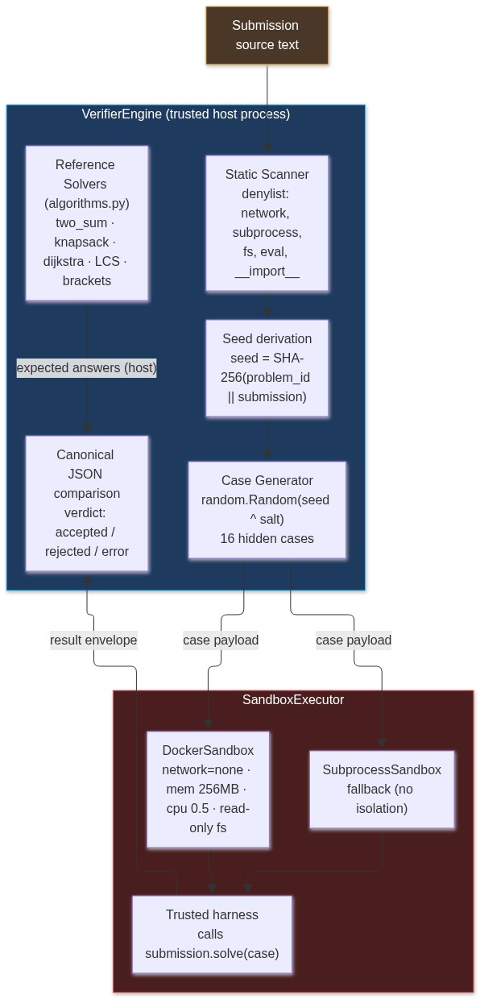

# System Architecture



## Component view

```
                       ┌──────────────────────────────────────────┐
                       │              VerifierEngine              │
                       │  (host process, trusted, fully typed)    │
                       └───────┬──────────────┬───────────────────┘
                               │              │
              ┌────────────────▼───┐   ┌──────▼──────────────────┐
              │  Static Scanner    │   │  Case Generator         │
              │  denylist of       │   │  random.Random(seed ^   │
              │  escape patterns   │   │  salt), SHA-256 bound   │
              └────────────────────┘   └──────┬──────────────────┘
                                              │ JSON case payload
                     ┌────────────────────────▼──────────────────┐
                     │           SandboxExecutor                 │
                     │  ┌─────────────────┐ ┌─────────────────┐  │
                     │  │ DockerSandbox   │ │ SubprocessSandbox│ │
                     │  │ network=none    │ │ (no isolation,  │  │
                     │  │ mem 256MB       │ │  fallback)      │ │
                     │  │ cpu 0.5, RO fs  │ └─────────────────┘  │
                     │  └────────┬────────┘                      │
                     └───────────┼───────────────────────────────┘
                                 │ harness.py + submission.py + case.json
                     ┌───────────▼───────────────────────────────┐
                     │  Trusted harness (runs beside untrusted   │
                     │  code): calls submission.solve(payload),  │
                     │  emits {"result": ...} JSON envelope      │
                     └───────────┬───────────────────────────────┘
                                 │ envelope
                     ┌───────────▼───────────────────────────────┐
                     │  Reference solver (algorithms.py)         │
                     │  recomputes ground truth on the host      │
                     │  canonical JSON comparison                │
                     └───────────────────────────────────────────┘
```

## Data flow (one verification run)

1. **Intake** -- the submission source arrives as text; nothing is executed yet.
2. **Static scan** -- a denylist scan rejects any pattern reaching outside
   the contract (network, processes, filesystem, dynamic evaluation).
3. **Seed derivation** -- `seed = SHA-256(problem_id || submission)[:8]`.
   The case set is bound to the exact submission text.
4. **Case generation** -- for each seed salt and each case index, a
   `random.Random(seed ^ salt)` stream generates one randomized input, and
   the reference solver computes the expected answer *in the host process*.
5. **Execution** -- for every case the sandbox writes three files into a
   fresh scratch directory (`submission.py`, trusted `harness.py`,
   `case.json`) and runs the harness.  In container mode each case gets a
   disposable container; in fallback mode a disposable child process.
6. **Grading** -- the envelope is canonicalized through sorted JSON and
   compared with the pre-computed expected value.  Verdicts:
   `accepted` (all cases pass), `rejected` (≥1 mismatch), `error`
   (≥1 sandbox-level failure).

## Why the reference runs outside the sandbox

A sandbox can only observe what untrusted code *produced*; it cannot prove
it *correct*.  Ground truth must therefore be computed by trusted code the
submission can never influence.  The submission is reduced to a pure
function `payload -> result`, and every comparison is against host-side
ground truth, never against submission-side claims.
